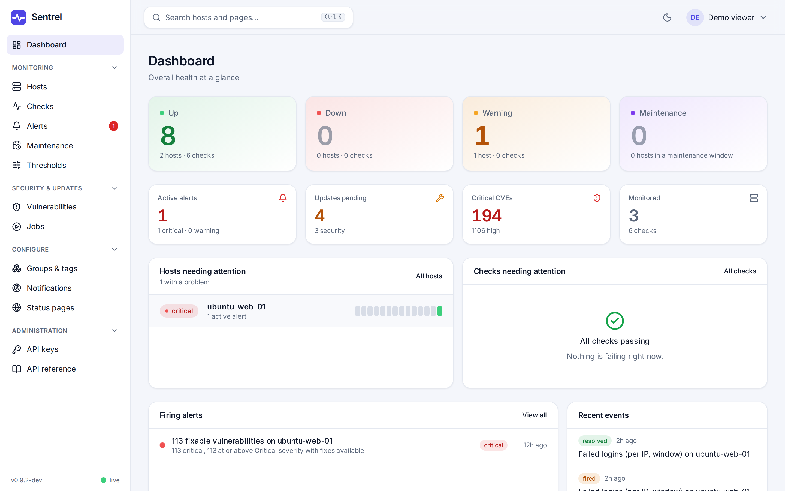
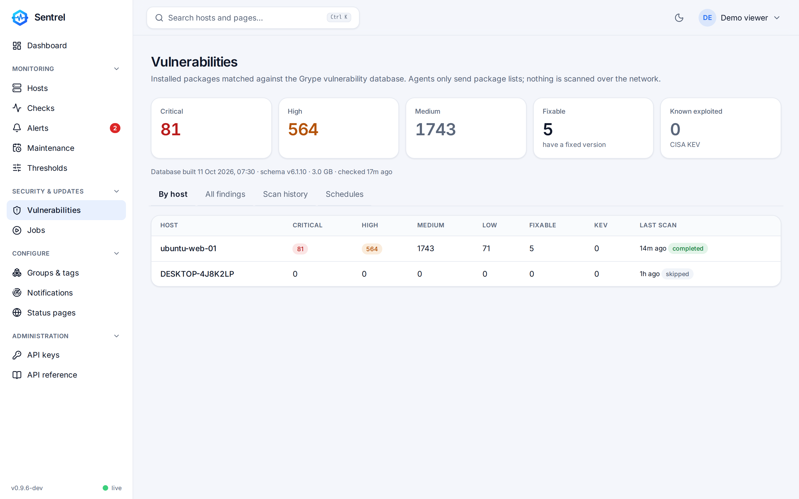
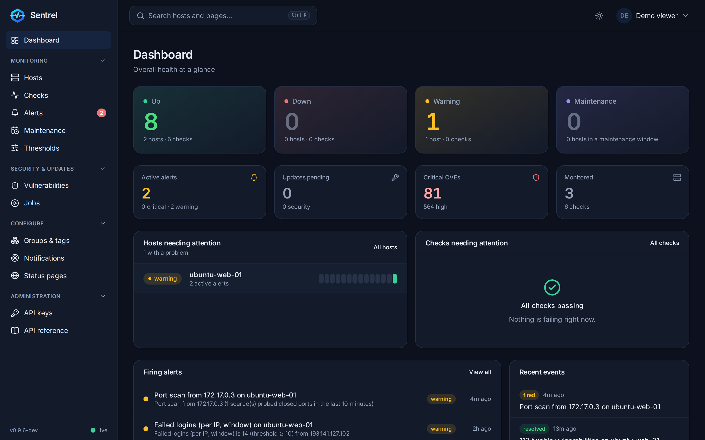
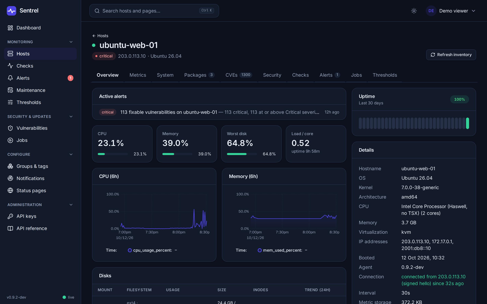

# Sentrel

A self-hosted monitoring server, agent and web UI: host metrics, uptime checks, SNMP, package updates, CVE matching and status pages in one small service.

Sentrel is for homelabs, small businesses and MSPs who want agent-based monitoring without assembling a metrics database, an exporter zoo, an uptime tool, a patch tracker and a dashboard layer. One Go server binary (UI, time-series store, vulnerability matcher and an internal certificate authority are built in), one small agent for Linux and Windows, and state in a single data directory. Multi-tenant isolation is built in, so an MSP can give each customer a view of only their own hosts. It is pre-1.0 software; see [Status](#status).

## Screenshots









## Features

**Monitoring**
- Agent metrics for Linux and Windows: CPU (including iowait and steal), memory, swap, load, disks and inodes with a "disk full in N hours" forecast, disk and network throughput, network errors, temperatures, processes, services, listening ports, Docker containers, uptime.
- Server-side checks: `ping`, `tcp`, `http` (status, keyword or regex, latency limit, basic auth, optional certificate expiry), `cert` (expiry with 30/14/7 day escalation) and `dns`.
- Agent-evaluated checks: `service`, `process`, `port`, `container`.
- SNMP v2c and v3 devices with YAML device profiles (generic, net-snmp, Cisco, Fortinet, HP/Aruba, MikroTik, Ubiquiti built in), interface counters and LLDP neighbours.
- Agentless "target" hosts monitored only by checks.
- Public or token-protected status pages with daily uptime history.
- Prometheus-format `/metrics` and a tenant-scoped PromQL query API.

**Alerting**
- Warning and critical thresholds with "N consecutive samples" confirmation, inherited global, tenant, group, host, with per-instance overrides.
- Flap detection, grouped notifications, repeat reminders, acknowledgements, per-rule muting, maintenance windows.
- Channels: webhook (Go template body), Discord, Slack, Microsoft Teams, Telegram, ntfy, Gotify, Pushover, email (SMTP).

**Patching and CVEs**
- Package inventory per host (apt, dnf/yum, zypper, pacman, apk; installed applications and pending updates on Windows).
- Remote package upgrades with dry run, off unless enabled per host.
- Optional CVE matching of Linux package inventories with an embedded [Grype](https://github.com/anchore/grype) engine: severity, CVSS, EPSS, CISA KEV, fix availability, ignore/reopen, schedules, alerts. Off by default (the database is about 3 GB). No CVE matching for Windows.
- SSH and failed-logon brute-force detection, fail2ban status, manual and automatic IP blocking.
- Disk usage analysis and opt-in disk cleanup.

**Access and tenancy**
- Roles (admin, operator, viewer, tenant admin, tenant viewer); tenants are isolated and can have their own branding.
- Local users (Argon2id), LDAP, RADIUS, OpenID Connect and forward-auth headers; TOTP and passkeys; optional 2FA enforcement; lockout; audit log.
- REST API with scoped API keys and an OpenAPI document.

**Operations**
- Agents connect outbound only. Self-update with signature check, self-test and automatic rollback.
- Backup and restore from the CLI or the UI.

## Quick start

Full details, upgrades and release verification (SHA256SUMS, cosign, SBOMs) are in [docs/install.md](docs/install.md).

**Docker**

```sh
docker run -d --name sentrel --cap-add NET_RAW -p 8080:8080 -v sentrel-data:/data \
  ghcr.io/notspark1999/sentrel:latest
docker logs sentrel 2>&1 | grep -i "setup token"
```

**Packages** (`.deb` and `.rpm`, amd64 and arm64, from the GitHub release page)

```sh
sudo apt install ./sentrel-server_<version>_amd64.deb      # or: sudo dnf install ./sentrel-server-<version>-1.x86_64.rpm
sudo systemctl enable --now sentrel
sudo cat /var/lib/sentrel/setup-token
```

**Install script** (Linux with systemd; installs the binary, a `sentrel` user and a hardened unit)

```sh
sudo sh install-server.sh --binary ./sentrel-server-linux-amd64
```

Open `http://<server>:8080/`, enter the setup token, create the administrator and pick a TLS mode ([docs/tls-and-proxies.md](docs/tls-and-proxies.md)). Then use **Add host** for a one-time token and the install command for Linux or Windows ([docs/agents.md](docs/agents.md)). The server runs on Linux only; agents run on Linux (amd64, arm64) and Windows (amd64).

## Security model

Details are in [docs/security.md](docs/security.md) and [docs/threat-model.md](docs/threat-model.md).

- The Linux agent runs as an unprivileged user. Root work goes through `sentrel-agent priv <verb>` via one sudo rule; each verb validates its arguments against allowlists and uses no shell.
- Agents connect outbound with client certificates from the server's internal CA. Every job is signed by the server, expires, and is checked by the agent (target, expiry, replay).
- Agent write policy is set only on the host, never by the server: `server` (default), `operator` (changes also need an offline Ed25519 signature that the server does not hold) or read-only. A fully compromised server cannot run scripts, upgrade packages or push binaries to `operator` or read-only agents.
- Destructive actions (upgrades, IP blocks, scripts, disk cleanup) are off per host until enabled, and need an explicit confirmation.
- Server-side checks and notifications from tenant-owned objects go through an SSRF guard that checks the address after DNS resolution and blocks private, loopback, link-local and metadata addresses.
- Known limits: with the default `server` policy the server is fully trusted by its agents, the database is not encrypted, integration secrets (SMTP, LDAP, RADIUS, webhook tokens) are stored in clear text in it, and backups contain the CA and job keys. These are spelled out in the threat model.

## Resource usage

Measured on a 2 vCPU, 3.8 GB VPS running the server and one agent plus two others (3 hosts), see [docs/operations.md](docs/operations.md#resource-usage) for the method and caveats. Your numbers will vary with host count and retention.

| Item | Measured |
|---|---|
| Server idle memory | about 120 to 150 MB |
| Server peak memory | about 575 MB, while scanning against the vulnerability database |
| Server CPU at idle | under 0.1% of one core |
| Agent memory | 13 to 15 MB (peak 22 MB) |
| Agent CPU | about 0.2% of one core at the default 30 s interval |
| Metric store | roughly 0.5 to 1 MB per host per day at default settings |
| Vulnerability database | about 3.1 GB, only if scanning is enabled |
| Binaries | server about 116 MB (UI and agent builds embedded), agent about 14 MB |

These come from a three-host test, not a large deployment. We have no figures for fleets of hundreds of hosts.

## How it compares

An honest comparison with Uptime Kuma, Beszel, Netdata, Zabbix, Checkmk and Prometheus with Grafana, including when you should use one of them instead, is in [docs/comparison.md](docs/comparison.md).

## Documentation

| Document | Contents |
|---|---|
| [docs/install.md](docs/install.md) | Server install, packages, container image, release verification, upgrade, ports |
| [docs/tls-and-proxies.md](docs/tls-and-proxies.md) | TLS modes, reverse proxies (Caddy), `trust_proxy`, recovery |
| [docs/agents.md](docs/agents.md) | Agent install, data collected, privilege model, write policy, self-update, troubleshooting |
| [docs/security.md](docs/security.md) | Security controls in detail |
| [docs/threat-model.md](docs/threat-model.md) | Assets, trust boundaries, attackers, residual risks |
| [docs/sso.md](docs/sso.md) | OpenID Connect (Authentik, Authelia, Keycloak, Google, Entra) and forward-auth headers |
| [docs/alerting.md](docs/alerting.md) | Thresholds, checks, flapping, maintenance, notification channels |
| [docs/snmp.md](docs/snmp.md) | SNMP devices and writing profiles |
| [docs/vulnerabilities.md](docs/vulnerabilities.md) | CVE matching, database, air-gapped mirror |
| [docs/disk.md](docs/disk.md) | Disk usage analysis and opt-in cleanup |
| [docs/api.md](docs/api.md) | REST API, API keys, Prometheus endpoint |
| [docs/operations.md](docs/operations.md) | Backup, restore, password reset, retention, resource usage, upgrades |
| [docs/comparison.md](docs/comparison.md) | Comparison with other monitoring tools |
| [docs/development.md](docs/development.md) | Repository layout, build, tests, protobuf |
| [CHANGELOG.md](CHANGELOG.md) | Release notes |
| [SECURITY.md](SECURITY.md) | Reporting vulnerabilities |
| [CONTRIBUTING.md](CONTRIBUTING.md) | Contribution rules and DCO sign-off |

## Status

Sentrel is pre-1.0. It is young and has not been run at large scale.

- Only the latest release is supported; fixes land there.
- Database migrations run automatically at server start and are never edited after release. There is no automated downgrade: take a backup (`sentrel-server backup`) before upgrading and restore it to roll back.
- Upgrade the server first, then the agents (from the UI). Agents older than the server keep working while the protocol schema version matches.
- Before 1.0, breaking changes (settings, API, packaging) can happen in any release. They will be listed in [CHANGELOG.md](CHANGELOG.md) with migration steps. There is no stability promise for the REST API yet.
- Installs from before the rename to Sentrel (see below) need a manual migration.

## Privacy

Sentrel has no telemetry, no analytics, no update check and no phone-home. I checked the server, agent and UI sources for outbound connections. The complete list of places where Sentrel makes outbound connections:

- **Vulnerability database download**: only if CVE scanning is enabled (off by default). The embedded Grype library fetches its listing and database from Anchore's public host unless you set a mirror URL in Settings. Updates are checked daily. With scanning off, the database is never downloaded or opened.
- **Agent to your server**: the agent connects to the server URL you registered it with and downloads updates from that same server. Nothing else.
- **Notification channels you configure**: webhook, Slack, Teams, Discord, Gotify, ntfy, Telegram (`api.telegram.org`), Pushover (`api.pushover.net`) and SMTP. The ntfy channel defaults to `https://ntfy.sh` if you leave its server field empty. Nothing is sent unless you create a channel.
- **Checks and targets you configure**: ping, TCP, HTTP, TLS certificate and DNS checksand SNMP polling go where you point them.
- **Identity providers you configure**: OIDC issuer, LDAP, RADIUS.
- **Let's Encrypt**: only if you choose the `acme` TLS mode.
- **Package managers on monitored hosts**: when an inventory refresh or upgrade runs, `apt`, `dnf` and the like (or Windows Update) contact their usual repositories. That is the operating system's own traffic, not Sentrel's.

The web UI loads no external fonts, scripts or other assets (the Inter font is bundled). I did not find any other outbound calls. Because this is an assertion about code, you can check it yourself or watch the server's connections.

## How this was built

Sentrel was developed with substantial AI assistance (Claude), directed, reviewed and tested by the maintainer. It has a Go test suite (unit tests, route tests that probe every `{id}` route for cross-tenant access, and live-event tenancy tests), an end-to-end script that runs against a real server and real agents, and a security review whose findings were fixed before this release. The e2e script is run by hand rather than in CI. Reports are welcome; see [SECURITY.md](SECURITY.md) for vulnerabilities.

## Contributing

See [CONTRIBUTING.md](CONTRIBUTING.md). Contributions need a DCO sign-off (`git commit -s`).

## Formerly Heartbeat

This project was previously named Heartbeat and was renamed Sentrel because Elastic already ships an uptime monitor called Heartbeat. Binaries, services, paths, the Go module, the protocol package, cookies, environment variables and metric prefixes were all renamed. Installs made before the rename must be migrated by hand (data directory, service and agent paths).

## Licence

Apache License 2.0, see [LICENSE](LICENSE). Third-party components and their licences are listed in [NOTICE](NOTICE).
