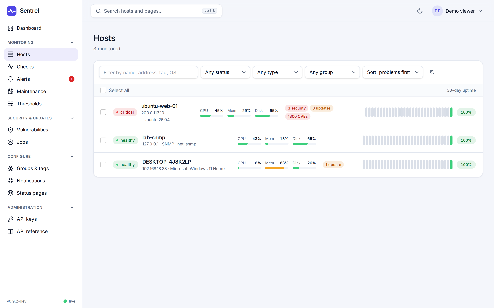
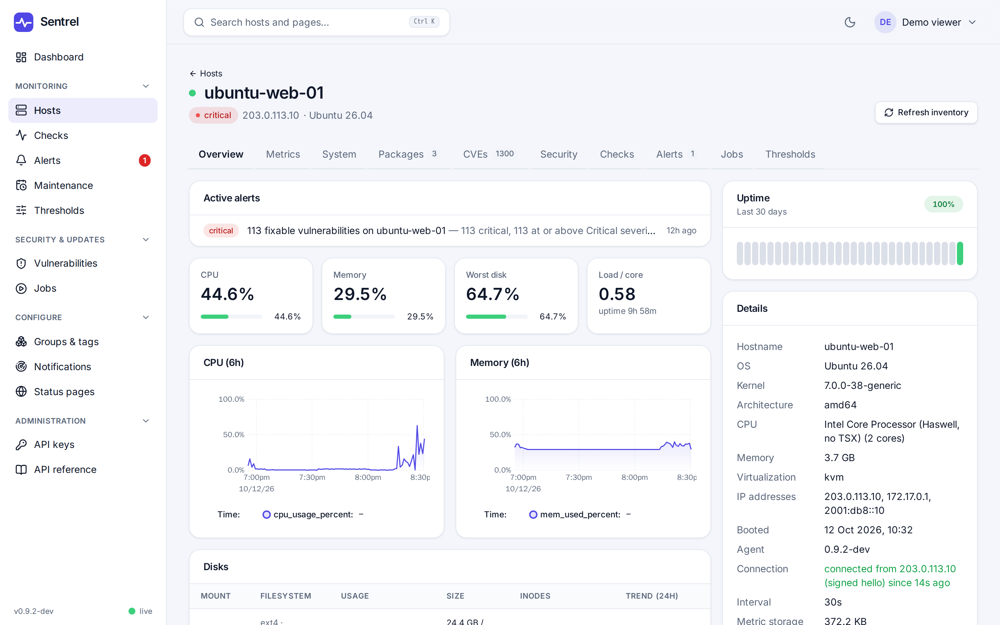
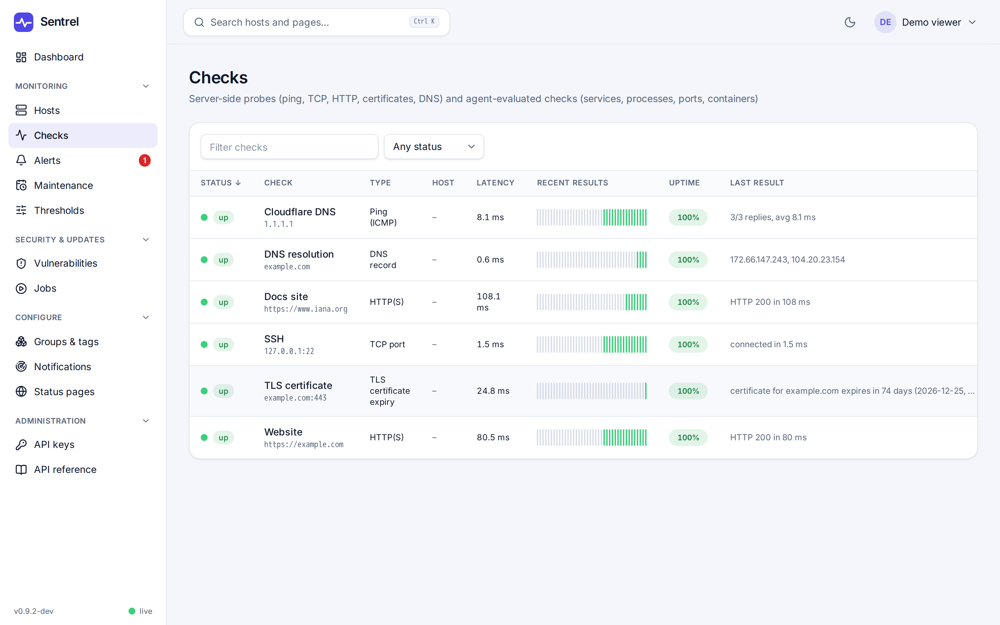

# Getting started

Five steps from nothing to a monitored host with an alert.

## 1. Install the server

```sh
docker run -d --name sentrel --cap-add NET_RAW -p 8080:8080 -v sentrel-data:/data \
  ghcr.io/xedigital/sentrel:latest
```

On a Linux host without Docker, use the install script or a `.deb`/`.rpm` package instead. All options, TLS and upgrades are in [install](install.md).

## 2. Run the setup wizard

Open `http://your-server:8080`. Enter the setup token (`docker logs sentrel 2>&1 | grep -i "setup token"`), create the administrator and pick a TLS mode ([TLS and proxies](tls-and-proxies.md)).

## 3. Add an agent

Go to **Agents**, choose Linux or Windows and copy the one-line install command into a terminal on the host. Within a minute the host appears under **Hosts**.



Click a host for graphs, services, packages and more. More options (packages, MSI, write policy) are in [agents](agents.md).

Per-host settings live next to the feature: security, brute-force, port-scan and blocking on **Security**, remote upgrades on **Packages**, disk cleanup in the storage breakdown on **Overview**. Each shows the value inherited from **Settings, Agents, Host defaults** and lets you override it for that host or reset it. See [security](security.md#privilege-boundary-and-opt-in-remote-actions).



## 4. Add a check

Open **Checks** and add an HTTP, TCP, ping, DNS or TLS check for a site or service. Checks run from the server and need no agent. See [alerting](alerting.md#checks).



## 5. Add a notification channel

Open **Notifications**, add a channel (email, Slack, Discord, Teams, Telegram, ntfy, Pushover, Gotify or a webhook) and send a test message. Alerts now reach you when a check or threshold fails. See [alerting](alerting.md#notification-channels).

## Next

- Turn on [vulnerability scanning](vulnerabilities.md) (off by default, about 3 GB of data).
- Publish a [status page](status-pages.md).
- Set up [backups](operations.md#backup).
